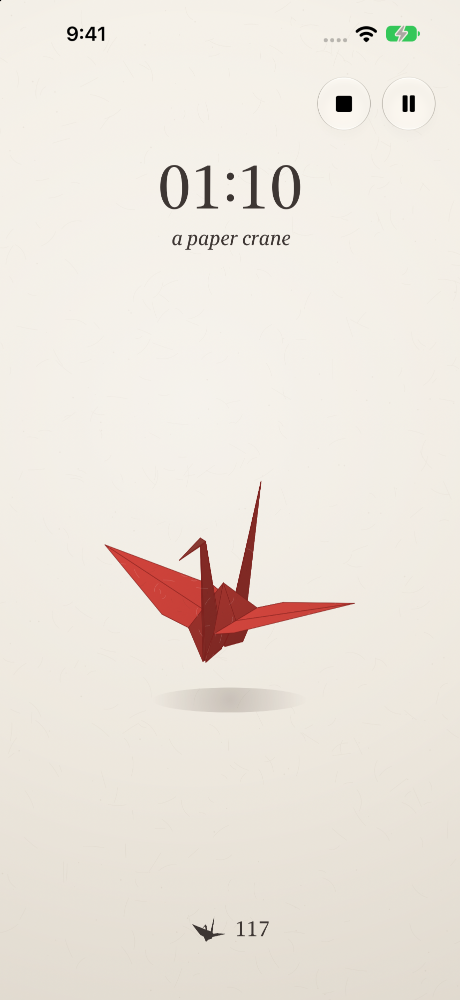

# Little While

Little While is a Pomodoro focus timer for iPhone. Set a focus block and a rest period, loop them as long as you like, follow the countdown from your Lock Screen, and see your focus time add up on a monthly calendar.

## Install

Little While requires iOS 18 or later.

## Using Little While

Tap the sliders button in the top left to open **Settings**. Choose a theme, set **Focus** (1 to 120 minutes) and **Rest** (0 to 120 minutes), and tap **Start**. When focus ends, Little While alerts you and moves straight into rest. Set Rest to 0 for a single focus block with no break.

- **Loop**: turn on Loop in Settings before tapping Start. When rest ends, the next focus block starts on its own, and focus and rest repeat until you tap stop.
- **Pause**: pausing is intentionally short. A paused timer shows a one-minute "Resuming in" countdown and then starts again by itself, so a quick interruption doesn't turn into an abandoned session. Tap play to resume sooner, or stop to end the run.
- **Stop and start over**: tap stop to end a run; its progress is kept in History. Touch and hold the play button to start a run over. The History and Settings buttons are hidden while a run is active and come back when you stop it.

### Themes

- **Boring**: a plain countdown.
- **Mr Smiles**: a smiley face that bounces around the screen while you work. Grab him and flick him off the walls.
- **He Loves Me**: a daisy that drops its petals one by one as time passes.
- **千羽鶴 (Paper Crane)**: a square of paper folds into an origami crane, one crane for every minute of focus, each in its own paper color. A running count shows how many cranes you've folded in total.

With Reduce Motion turned on, the themes stay still.

### History

Tap the clock button in the top left to open **History**. A monthly calendar marks each day with a dot that grows with how much you focused that day; use the arrows or swipe to change months. Below it, each run is listed with its date and time, time spent, theme, and, for looped runs, the number of completed cycles. Swipe left on a past run to delete it.

### Lock Screen and alerts

While a timer runs, a Live Activity shows the time left and whether you're in focus or rest on the Lock Screen and, on iPhones that have one, in the Dynamic Island.

Allow notifications when asked so you hear when each period ends. On iOS 26 or later, Little While can also schedule system alarms for the end of each focus and rest period. These sound even in Silent mode or a Focus, and you can stop them right from the alert. If alarms aren't available or allowed, Little While uses notifications instead.

### Privacy

There's no account, ads, analytics, or tracking. Your settings and history stay on your iPhone. See [Support](docs/support.md) for help and the [Privacy Policy](docs/privacy-policy.md).

## Contributing

Issues welcome.

## License

MIT
